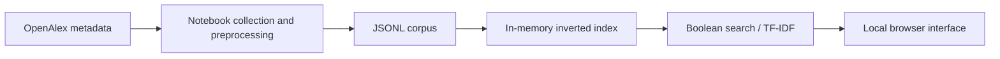

# Academic Paper Search

[](https://colab.research.google.com/github/aitanacanto/AcademicPaperSearch/blob/main/notebooks/academic_paper_search.ipynb) · [Run locally](#run-locally)

**A local search engine for literature on document verification, misinformation and LLM reliability.**

Individual academic project by **Aitana Cantó Rico** for **Information Retrieval**, University of West Attica, Greece, academic year **2025-2026**.


## Open the notebook in Colab

Click **Open in Colab** above to explore and execute the notebook in your browser. GitHub displays a static preview; Colab lets you run the cells and use the notebook widgets.

Connect to a runtime, then run the collection, preprocessing and indexing cells before using the search interface. The console-search cells wait for queries: enter `exit` to continue. Evaluation is optional when you only want to try the interface.

Access follows the repository's visibility. If the repository is private, Colab needs an authorized GitHub account with access to it. You can also download the notebook and upload it to Colab yourself.

For the standalone browser application, use the local instructions below. Both options use the same retrieval methods.

## Run locally

From this repository folder, run:

```bash
python app.py
```

The interface opens in your browser at **http://127.0.0.1:8765**. Keep the terminal open while searching; press **Ctrl+C** to stop. The application itself uses only Python's standard library, with no Colab account or web framework required.

It automatically finds JSONL data generated by the notebook under `data/` or `notebooks/data/`. To select another corpus:

```bash
python app.py --data path/to/processed_papers.jsonl
```

A fresh clone needs a corpus: generate one with the notebook's collection and preprocessing cells, or provide a compatible JSONL file. Without data, the interface opens with instructions rather than displaying invented results.

## Features

- Boolean search with `AND`, `OR`, `NOT` and parentheses.
- TF-IDF ranking using log-scaled term frequency and smoothed IDF.
- Paper titles, publication details, abstracts and source links.
- Result limits and example queries.
- Local searches without external API calls.



## Notebook

The [notebook](notebooks/academic_paper_search.ipynb) retains the collection, indexing, evaluation and widget interface. It can be used in **VS Code, Jupyter or Colab**; Colab-specific widget setup is conditional.

The standalone interface is a later presentation addition. Its eight retrieval functions are preserved from the notebook, and local tests confirm agreement with the notebook-generated index.

## Academic experiment

The [original report](docs/report.pdf) describes 630 collected papers, 615 indexed documents and 12 manually judged queries. A newly collected corpus may differ. The current interface screenshot comes from a fresh local corpus, not the historical evaluation.

The original top-10-only relevance judgments do not establish recall across the corpus. See [reproducibility and metric scope](docs/REPRODUCIBILITY.md).

[Setup and troubleshooting](docs/SETUP.md) · [Academic context and acknowledgements](docs/ACADEMIC_CONTEXT.md)
